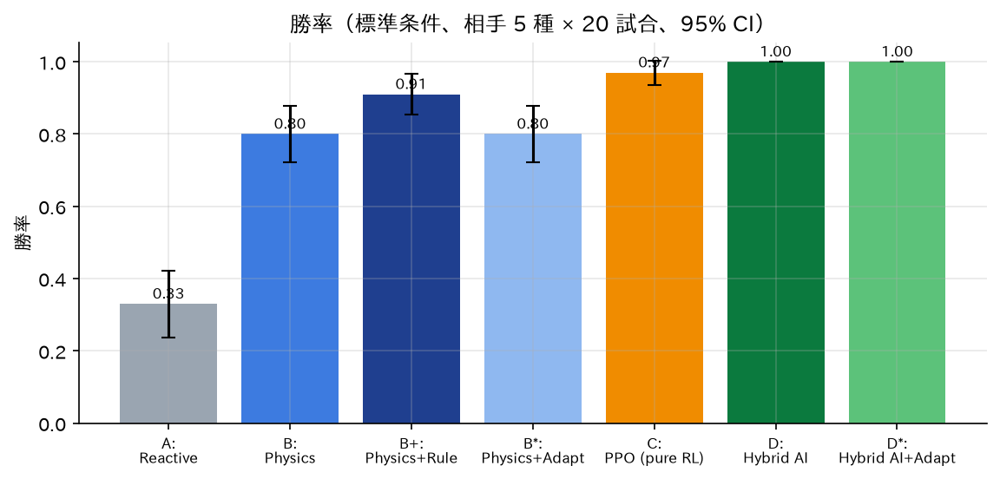
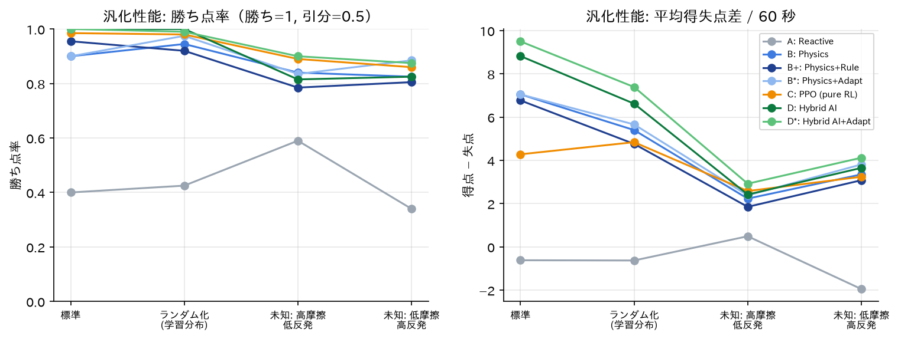
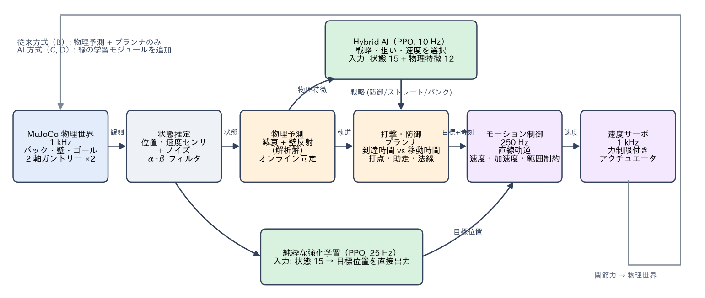

# Adaptive Air Hockey AI（air-hockey）

物理シミュレータ MuJoCo 上で、**パックの軌道を物理モデルで予測し、相手と環境に応じて戦い方を学習で選ぶ**
エアホッケーロボットです。Physical AI 応用1 講座 最終課題（OmniCampus: `yoichiozaki`）。

> 研究課題: 従来の物理モデルによる予測制御と比較して、機械学習を用いた戦略選択・予測補正は、
> 対戦性能と未知環境への適応能力を改善できるか？

| 提出物 | 場所 |
|---|---|
| デモ動画（MP4, 約 150 秒） | [`videos/PAI最終課題_yoichiozaki.mp4`](videos/PAI最終課題_yoichiozaki.mp4)（YouTube: 「PAI最終課題_yoichiozaki」） |
| 説明資料（PDF） | [`reports/説明資料_PAI最終課題_yoichiozaki.pdf`](reports/説明資料_PAI最終課題_yoichiozaki.pdf) |
| 実験の生データ | [`results/eval_main/`](results/eval_main/)（試合ごとの CSV、集計 CSV/JSON） |

<!-- RESULTS:START -->
## 結果（要約）

- **Hybrid AI（物理予測 + 強化学習の戦略選択）** は標準条件で勝率 100%（物理予測制御 80%、ルールベース選択 91%）、得点 9.2 点/60 秒（物理予測制御 7.3）。対応のある比較で得失点差 +1.77 [95% CI +0.98, +2.54]。
- 物理予測制御が 1 点も取れない **守備型の相手** に対し、Hybrid AI は 5.65 点/60 秒・全勝。相手ごとに戦略（例: 静止相手には右壁バンク 89%）を使い分ける。
- **未知の物理条件** では学習だけでは改善せず（勝率 70–78%）、オンライン同定を加えた Hybrid AI+Adapt で 82% / 82%、予測誤差は約半分。
- **純粋な強化学習** は勝率 97% だが得点は 4.8 点と少なく、物理の構造を使う Hybrid の方が少ない学習量で高性能。

勝率 / 平均得失点差（60 秒の試合、相手 5 種 × 20 試合、評価シードは学習と非重複）:

| 制御器 | 標準 勝率 / 得失点差 | ランダム化 勝率 / 得失点差 | 未知(高摩擦) 勝率 / 得失点差 | 未知(高反発) 勝率 / 得失点差 |
|---|---|---|---|---|
| A: Reactive | 33% / -0.62 | 32% / -0.63 | 52% / +0.49 | 25% / -1.95 |
| B: Physics | 80% / +7.05 | 91% / +5.40 | 71% / +2.23 | 79% / +3.35 |
| B+: Physics+Rule | 91% / +6.77 | 86% / +4.76 | 63% / +1.85 | 75% / +3.08 |
| B*: Physics+Adapt | 80% / +7.05 | 95% / +5.66 | 70% / +2.38 | 84% / +3.81 |
| C: PPO (pure RL) | 97% / +4.28 | 97% / +4.84 | 79% / +2.58 | 84% / +3.24 |
| D: Hybrid AI | 100% / +8.82 | 100% / +6.62 | 70% / +2.42 | 78% / +3.65 |
| D*: Hybrid AI+Adapt | 100% / +9.50 | 98% / +7.39 | 82% / +2.92 | 82% / +4.12 |



<!-- RESULTS:END -->

## 何ができるか

- **物理的に正しいロボット**: 2 軸ガントリー（X ブリッジ・Y キャリッジ）をスライド関節と力制限付き速度サーボで駆動。
  位置・速度・加速度の制約は MuJoCo のアクチュエータ/関節と低レベル制御で表現（座標の直接書き換えはしない）。
- **物理予測制御（従来方式）**: 減衰と壁反射を含む解析解で軌道を予測し、「パック到達時刻 vs ロボット移動時間」で
  到達可能な打点だけを選ぶ。打撃は時刻指定で開始し、方向誤差は平均 0.1°。
- **AI**:
  - **Hybrid AI（PPO）**: 戦略（防御／ストレート／左右バンク）・狙い・打球速度を状況と相手に応じて選択し、物理プランナが実行。
  - **純粋な強化学習（PPO）**: 目標位置を直接出力（比較対象）。
  - **オンライン適応**: 減衰率と反発係数を試合中に同定して予測を補正。センサノイズは α-β フィルタで処理。
- **評価**: 7 制御器 × 相手 5 種 × 条件 4 種（未知条件を含む）× 20 試合を並列実行し、CSV/JSON と図を自動生成。
- **可視化**: 予測軌道・壁反射点・予測打撃点・狙いのコース・ロボット目標を 3D シーンに重ね、日本語 HUD 付きでヘッドレス録画。

## アーキテクチャ



```
src/hockey/
  simulation/     MJCF 生成, HockeySim (1 kHz), モーション制御 (250 Hz), 試合ルール
  observation.py  プレイヤー座標系, センサノイズ, 観測ベクトル
  controllers/    予測 (prediction), 計画 (planning), 物理制御, 追従制御, 相手, 適応, 学習済み方策
  learning/       Gymnasium 環境, 報酬, カリキュラム, 行動インタフェース, PPO 学習
  evaluation/     試合実行, 指標トラッカ, 条件 (DR/未知), 実験ランナ
  visualization/  オフスクリーン描画, オーバーレイ, HUD, 動画書き出し
  infrastructure/ 環境診断 (doctor), Colab ジョブ計画
scripts/          train / evaluate / render / benchmark / make_figures / make_video / make_report / colab_*
configs/          training/*.yaml, evaluation/*.yaml
tests/            unit / integration / physics
```

学習アルゴリズムの差し替えは `learning/actions.py`（行動インタフェース）だけで完結し、すべての行動は
モーション制御（物理制約）を通ってアクチュエータに渡ります。

## セットアップ（VS Code Dev Container）

前提: Docker Desktop（WSL2）、VS Code + Dev Containers 拡張。ホストに Python は不要です。
開発環境はリポジトリ直下の `.devcontainer/` にあります。

1. リポジトリのルートを開き、コマンドパレットで **Dev Containers: Reopen in Container**。
2. 初回ビルド後、自動でパッケージの `pip install -e` と環境診断 `python -m hockey.infrastructure.doctor` が実行されます
   （MuJoCo のヘッドレス描画 EGL、FFmpeg、日本語フォントを確認）。
3. ターミナルで `cd air-hockey` してから以下のコマンドを実行します。
4. GPU は任意です（`hostRequirements.gpu: optional`）。PPO の MlpPolicy は CPU の方が速いため既定は CPU 版 PyTorch。

VS Code を使わない場合（リポジトリのルートで）:

```powershell
docker build -t pai-dev -f .devcontainer/Dockerfile .
docker run -d --name pai-dev --shm-size=2g -v "${PWD}:/workspaces/physical-ai-robot-sports" `
    -v pai-hockey-colab-cli:/home/vscode/.config/colab-cli pai-dev sleep infinity
docker exec pai-dev bash -c "pip install --no-deps -e air-hockey && cd air-hockey && make doctor && make test"
```

依存関係はリポジトリ直下の `requirements/lock.txt` に完全固定（Python 3.11.17, MuJoCo 3.15.0, Gymnasium 1.4.0, SB3 2.9.0, PyTorch 2.14.1 CPU）。

## 使い方

```bash
make test                     # pytest（物理・単体・統合）
make lint                     # ruff
python scripts/benchmark.py   # 物理校正・予測/打撃精度・防御ドリル -> results/benchmark.json

# ローカルでシミュレーションを見る（MP4 + JSON ログ）
python scripts/render.py --scene strike --out videos/clips/strike.mp4
python scripts/render.py --scene match --home physics --away aggressive --duration 20 --out videos/clips/match.mp4
python scripts/render.py --scene bank_defense --camera top --speed 0.5 --out videos/clips/bank.mp4

# 学習（チェックポイント・評価・ログは checkpoints/<run>/）
python scripts/train.py --config configs/training/ppo_hybrid.yaml --seed 0 --run-name ppo_hybrid_s0
python scripts/train.py --config configs/training/ppo_direct.yaml --seed 0 --run-name ppo_direct_s0
python scripts/train.py --config configs/training/ppo_direct.yaml --run-name ppo_direct_s0 \
    --resume checkpoints/ppo_direct_s0/checkpoints/ckpt_4000000_steps.zip     # 再開

# 評価 → 図 → 動画 → レポート
python scripts/evaluate.py --config configs/evaluation/main.yaml
python scripts/make_figures.py
python scripts/make_video.py
python scripts/make_report.py
```

制御器の指定（`--home` など）: `reactive` / `physics` / `physics_heuristic` / `physics_adaptive` /
`ppo:<model.zip>` / `hybrid:<model.zip>` / `hybrid_adaptive:<model.zip>`、相手: `stationary` / `random` /
`reactive` / `defensive` / `aggressive`。

## Google Colab での実行

公式 **google-colab-cli 0.7.4** を Dev Container に導入済みです（Python 3.12 を uv で分離。`colab --help` で全コマンドを確認済み）。
OAuth トークンは名前付きボリューム `pai-hockey-colab-cli`（コンテナ内 `~/.config/colab-cli`）に保存され、イメージや Git には入りません。

**初回認証（1 回だけ、対話操作）** — Windows の PowerShell から:

```powershell
docker exec -it pai-dev colab --auth oauth2 usage
```

1. 表示された URL をブラウザで開き、Colab の契約（Google AI Pro）がある Google アカウントでログインして許可します。
2. 表示された認証コードをコピーし、ターミナルの `Enter the authorization code:` に貼り付けて Enter。
3. `Current balance: … compute units` が出れば完了です。`usage` は残高を表示するだけで、計算ユニットは消費しません。

サインアウトは `docker exec pai-dev rm /home/vscode/.config/colab-cli/token.json` を実行し、
<https://myaccount.google.com/permissions> でアクセス権を削除します。

```bash
python scripts/colab_smoke_test.py --out results/colab/smoke_local.json   # 1. ローカル smoke test
python scripts/colab_job.py plan --hours 0.5 --gpu T4                      # 実行コマンドと CU 見積りを表示
python scripts/colab_job.py run --hours 0.5 --i-approve-auth --i-approve-cu 1.0   # 認証・CU 使用を明示して実行
```

計画の中身: `colab --auth oauth2 new -s hockey --gpu T4` → `colab upload`（ソース一式）→ `colab exec -f scripts/colab/remote_setup.py`
（依存導入 + GPU smoke test）→ `colab drivemount` → `colab exec -f scripts/colab/remote_train.py`（Drive にチェックポイント、切断時は自動再開）
→ `colab download` → `colab stop` → `colab usage`（CU 記録）。ノートブック版は [`notebooks/colab_train.ipynb`](notebooks/colab_train.ipynb)。
5 CU を超える見込みのジョブは `--i-approve-cu` で明示承認が必要です。本研究の学習はすべてローカル CPU で行いました（CU 使用量 0）。

## 再現性

- 乱数: 学習シード（`--seed`）、評価シード 10000 番台（学習と非重複）、試合ごとに `numpy.random.Generator` を派生。
- 物理の決定性: 同じシード・同じ制御器で同一の軌跡（`tests/physics/test_physics.py::test_fixed_seed_reproducibility`）。
- 記録: `checkpoints/<run>/run_info.json`（バージョン、ハイパーパラメータ、学習時間、git commit）、`results/eval_main/meta.json`。
- 図は `python scripts/make_figures.py` で CSV から再生成できます。動画の各シーンはシード付きの決定的再生（`videos/video_manifest.json`）。

## トラブルシューティング

| 症状 | 対処 |
|---|---|
| `offscreen render FAILED` | `export MUJOCO_GL=osmesa PYOPENGL_PLATFORM=osmesa`（CPU レンダリング） |
| 学習が遅い | `--n-envs` を CPU コア数に合わせる。`torch_threads` は 2–4 |
| 動画の日本語が豆腐になる | Dev Container 外では `fonts-ipaexfont-gothic` を導入 |
| Windows で改行コードの問題 | `.gitattributes` で LF に統一済み。`git rm --cached -r . && git reset --hard` で再チェックアウト |

## 開発ルール・記録

[`AGENTS.md`](../AGENTS.md)（開発規則、リポジトリ共通）、[`PLAN.md`](PLAN.md)、[`STATUS.md`](STATUS.md)、[`DECISIONS.md`](DECISIONS.md)（設計判断）、
[`EXPERIMENTS.md`](EXPERIMENTS.md)（実験記録）。

## ライセンス・クレジット

- コード: MIT License（[`LICENSE`](../LICENSE)）。
- 使用ソフトウェア: MuJoCo (Apache-2.0), Gymnasium (MIT), Stable-Baselines3 (MIT), PyTorch (BSD-3-Clause),
  NumPy/SciPy/pandas/Matplotlib (BSD 系), ReportLab (BSD), FFmpeg (LGPL/GPL, コンテナ内で使用),
  google-colab-cli (Apache-2.0)。
- フォント: IPAex ゴシック/明朝（IPA フォントライセンス v1.0、Debian パッケージから利用。PDF にはサブセット埋め込み）。
- 3D モデルは MJCF をコードから生成しており、外部アセットは使用していません。
