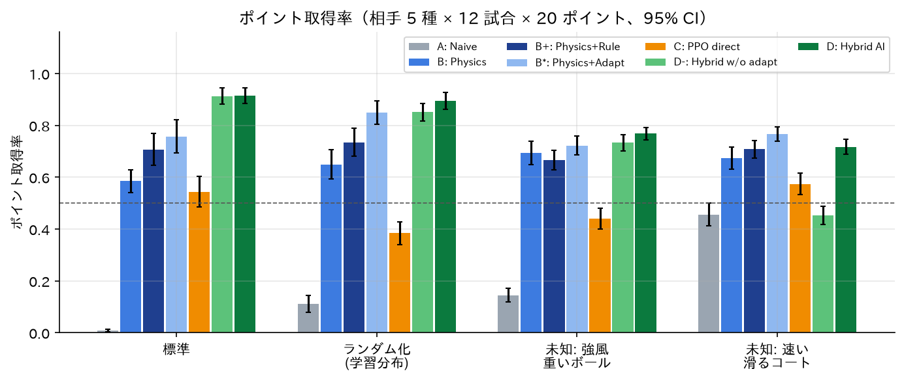
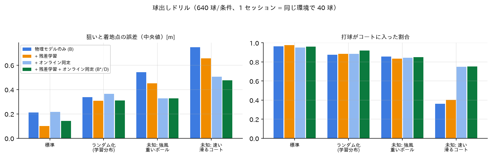
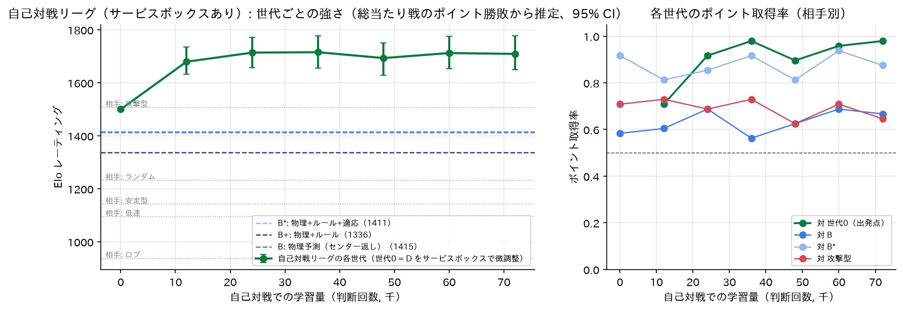
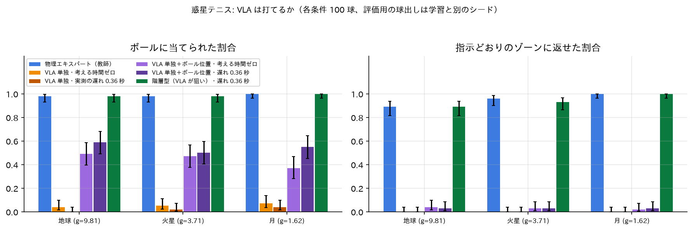
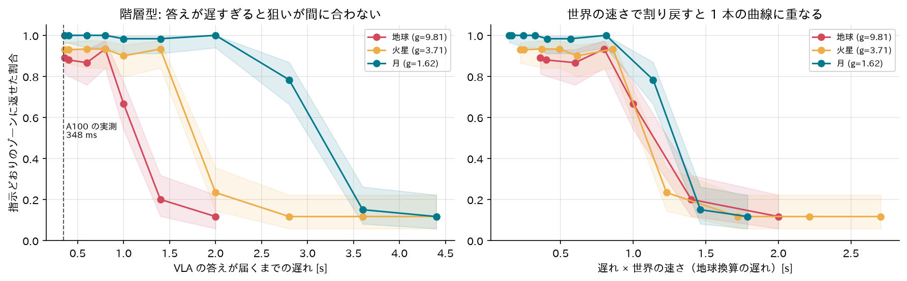
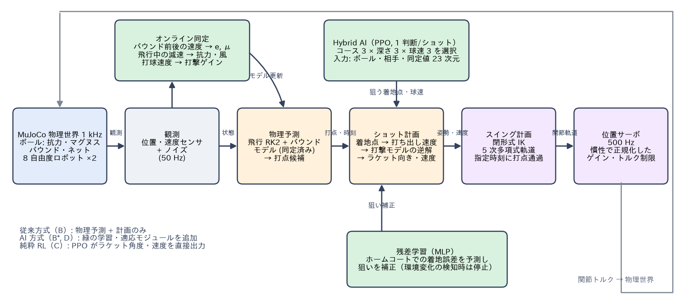

# Robot-Arm Tennis AI（robot-arm-tennis）

物理シミュレータ MuJoCo 上で、**8 自由度のロボットアーム同士がテニスをする**環境を一から作り、
「物理モデルによる予測・計画」「学習（戦術の強化学習・着地誤差の残差学習）」「オンライン適応」を組み合わせた
対戦 AI を構築・評価したプロジェクトです。Physical AI 応用1 講座 最終課題（OmniCampus: `yoichiozaki`）。
> 研究課題: 物理モデルによる予測・計画に、学習とオンライン適応を組み合わせると、
> 対戦性能と未知環境への頑健性は向上するか？

| 提出物 | 場所 |
|---|---|
| デモ動画（MP4, 約 174 秒） | [`videos/PAI最終課題_yoichiozaki.mp4`](videos/PAI最終課題_yoichiozaki.mp4) |
| 説明資料（PDF） | [`reports/説明資料_PAI最終課題_yoichiozaki.pdf`](reports/説明資料_PAI最終課題_yoichiozaki.pdf) |
| 実験の生データ | [`results/eval_main/`](results/eval_main/)（試合ごとの CSV、集計 CSV/JSON）、[`EXPERIMENTS.md`](EXPERIMENTS.md) |

<!-- RESULTS:START -->
## 結果（要約）

- **Hybrid AI（D）** のポイント取得率は全条件で 82.4%。同じ物理・適応層で狙いを手作りルールで決める B* との差 +5.0 pt [95% CI +3.0, +7.0]、物理予測制御 B との差 +17.4 pt [95% CI +14.5, +20.3]（同じ相手・条件・シードの対応比較）。
- **オンライン適応**（B* − B+）: 標準 +5.0 pt [95% CI +1.7, +8.2]、未知: 強風 +5.6 pt [95% CI +1.3, +9.8]、未知: コート +5.9 pt [95% CI +2.7, +9.4]。適応層を外した D− との差 D − D− は 未知: コートで +26.3 pt [95% CI +22.6, +30.1]。
- **純粋な強化学習（C）** は 48.5%（D − C = +33.9 pt [95% CI +30.6, +37.2]）。ラケット角度から打球の行き先を学ぶのは、同程度の学習量では難しい。
- **限界**: 未知: コートでは学習した戦術が手作りルール + 適応に劣る（D − B* = -5.1 pt [95% CI -8.3, -1.8]）。未知の環境での頑健性は主にオンライン同定が担い、戦術そのものの適応は今後の課題。
- **物理モデルの効果**（B − A）: +47.0 pt [95% CI +44.0, +50.0]。

ポイント取得率（相手 5 種 × 12 シード × 20 ポイント、評価シードは学習と非重複、未知条件は学習に不使用）:

| 制御器 | 標準 | ランダム化 | 未知: 強風 | 未知: コート | 全体 |
|---|---|---|---|---|---|
| A: Naive | 0.9% | 11.1% | 14.5% | 45.6% | **18.0%** |
| B: Physics | 58.5% | 64.9% | 69.3% | 67.3% | **65.0%** |
| B+: Physics+Rule | 70.8% | 73.5% | 66.7% | 70.8% | **70.4%** |
| B*: Physics+Adapt | 75.8% | 84.9% | 72.2% | 76.8% | **77.4%** |
| C: PPO direct | 54.4% | 38.4% | 44.0% | 57.3% | **48.5%** |
| D-: Hybrid w/o adapt | 91.2% | 85.1% | 73.3% | 45.3% | **73.8%** |
| D: Hybrid AI | 91.6% | 89.5% | 76.8% | 71.7% | **82.4%** |



<!-- RESULTS:END -->

## 発展編

### 発展 1: 自己対戦でさらに強くなれるか（[EXPERIMENTS E8–E9](EXPERIMENTS.md)）

- D を出発点に、自分の過去の世代と戦い続ける**自己対戦リーグ**（AlphaStar 方式の簡略版: 1.2 万判断ごとに世代を追加、苦手な過去の世代を
  優先して選ぶ PFSP、2 割はスクリプト相手）を学習し、総当たり戦から Elo を推定した（`scripts/league_eval.py`）。
- **元のルールでは強くならなかった（全世代 Elo 1484–1507）。** 学習済み方策のサーブ（深く・受け手のフォア側・7 m/s）は 99.9% がエース。
  ベースライン際で低く弾んで受け手ロボットの台座の横を抜け、レールが後ろへ下がれないため誰も返せない（設計上の死角）。D 自身が元の学習で
  見つけていた。サーブで勝負が決まるゲームでは強さの差が生まれない（`python scripts/diagnostics/serve_trace.py`）。
- 実際のテニスと同じ**サービスボックス**（サーブはネットから 1.62 m 以内）を加えてやり直すと、ラリーは 1 ポイント 3.2 打、Elo は
  **+215** まで上がって頭打ち。ただし上昇の大部分は出発点への圧勝（最終世代が世代 0 から 98% のポイント）で、固定の相手（B・B*・攻撃型）
  へのポイント取得率はほぼ変わらない。



### 発展 2: VLA はテニスができるか — 惑星テニス（[EXPERIMENTS E10](EXPERIMENTS.md)）

- **SmolVLA**（4.5 億パラメータ、LeRobot）を物理エキスパートの成功デモ 1,673 本（カメラ画像 2 枚 + 関節 + 英語の指示文 → 関節目標と狙い）で
  Colab の A100 で微調整し、言語指示つきの返球ドリル（相手の位置を見ないと従えない指示を含む）で評価した（`scripts/vla/`）。
- **重力だけを変える**（地球・火星・月）と軌道の形はそのままで時間だけが伸びる。「試合の速さ」だけを変えて、VLA の推論の遅れ（A100 実測
  0.35 秒）の影響を測った。
- **VLA 単独（画像 → 関節）はほぼ当たらない**（命中 0–7%）。考える時間をゼロにしても、2.5 倍遅い月でも同じ。
- 対照実験で**ボールの位置と速度を直接入力**すると、命中は遅れ 0 で 37–49%、最良の条件で 69% に上がる（画像からボールを捉えるのが
  最初の壁）。それでも当たった球のうちコートに入るのは 21% で、狙ったゾーンにはほとんど返せない（打球の精度が次の壁）。命中率は遅れの
  長さよりも、行動チャンクを切り替える周期で大きく変わった。
- **階層型（VLA が画像と指示から狙いを決め、物理層が打つ）は教師と同等**（指示どおり 89–100%、相手を見ないと従えない指示でも 87–100%）。
  許される「考える時間」は地球 1.1 秒・火星 1.8 秒・月 3.1 秒で、世界の速さに比例する。




## 何ができるか

- **3 次元のテニス**: 6.0 × 2.4 m のミニコート、ネット、実物の硬式テニスボール（空気抵抗・マグヌス力・バウンド・ネット）。
  シングルス相当のルール（ワンバウンドのドロップサーブ、2 バウンド・アウト・ネット・二度打ちで失点、サーブ交代）。
- **物理的に正しいロボット**: 床の 2 軸ガントリー + 肘付き 6 軸アーム（球面手首）+ ラケット（8 自由度）× 2 台。
  各関節は慣性から設計した位置サーボ（速度・加速度フィードフォワード、関節間の慣性結合を考慮したトルク上限、重力補償）。
  閉形式の逆運動学（MuJoCo と 1e-9 で一致）で、打点・ラケット面の向き・ラケット速度を指定時刻に実現するスイングを 5 次多項式で生成。
- **物理予測制御（従来方式）**: 同定した空力・バウンドモデルで軌道を予測 → 到達可能な打点を選択 → 弾道ソルバで狙いの着地点への
  打ち出し速度 → 実スイングから同定した打撃モデルの逆解でラケットの向きと速度 → IK とスイング計画。「バウンドを見てから打つ」。
- **AI**:
  - **Hybrid AI（PPO）**: 相手と状況を見てコース（左右 3 × 深さ 3）と球速（3 段階）を選び、物理層が実行（提案手法 D）。
  - **純粋な強化学習（PPO）**: ラケット面の角度とラケット速度を直接出力（比較対象 C）。
  - **残差学習（MLP）**: ホームコートの練習で狙いと着地点のずれを学習し、狙いを補正。
  - **オンライン同定**: バウンド前後の速度から反発・摩擦、飛行中の減速から抗力・風、打球速度から打撃ゲインを試合中に推定。
    標準モデルから有意に離れたときだけ使い（変化検知）、そのとき残差補正は止める。
- **評価**: 7 制御器 × 相手 5 種 × 条件 4 種（未知条件 2 種を含む）× 12 シード × 20 ポイントを並列実行し、CSV/JSON と図を自動生成。
- **可視化**: 予測軌道・バウンド点・計画した打点・打球の予測軌道・狙いの着地点を 3D シーンに重ね、日本語 HUD（戦術・動作・
  オンライン同定値）付きでヘッドレス録画。

## アーキテクチャ



```
src/tennis/
  sim/          MJCF 生成 (mjcf), 設定 (config), 運動学・閉形式 IK (kinematics), 5 次多項式軌道 (trajectory),
                物理ステップ・サーボ・接触イベント (physics), 審判 (game)
  control/      弾道予測・ショットソルバ (ballistics), 打点候補・打撃モデル・スイング計画 (planner),
                プレイヤー・相手 5 種 (players), 制御器ファクトリ (factory)
  learning/     残差モデル (residual), オンライン同定 (adaptation), Gymnasium 環境 (env), PPO 学習 (train), 方策のデプロイ (policy)
  evaluation/   試合 (match), ドリル (drills), 条件 (conditions), 実験ランナー (experiments)
  viz/          オーバーレイ描画 (renderer), HUD (hud), クリップ録画 (recorder), MP4 書き出し (video)
scripts/        calibrate*.py（同定）, residual.py（残差の収集・学習・ドリル評価）, evaluate.py, make_figures.py,
                make_video.py, make_report.py
configs/        training/*.yaml（PPO）, evaluation/*.yaml（評価グリッド）
tests/          unit（IK/FK・予測・計画・同定）, physics（バウンド・静止・サーボ追従）, integration（環境・試合・ランナー）
```

## 使い方（Dev Container 内、このディレクトリで）

```bash
python -m pytest -q                                                   # テスト（約 30 秒）
python scripts/calibrate.py && python scripts/calibrate_impact.py     # 物理モデルの同定
python scripts/residual.py collect --condition nominal --tag nominal  # 残差学習データ（--seed を変えて nominal2 も）
python scripts/residual.py train --data hits_nominal.npz hits_nominal2.npz
python scripts/residual.py evaluate --hits 640                        # ドリル評価（図4）
python -m tennis.learning.train --config configs/training/ppo_hybrid.yaml   # D（約 1.5 時間, CPU）
python -m tennis.learning.train --config configs/training/ppo_direct.yaml   # C
python scripts/evaluate.py --config configs/evaluation/main.yaml      # 1,680 試合（20 並列で約 30 分）
python scripts/make_figures.py && python scripts/make_video.py && python scripts/make_report.py
```

短い動作確認: `python -m tennis.learning.train --config configs/training/smoke.yaml --out /tmp/smoke`、
`python scripts/evaluate.py --config configs/evaluation/quick.yaml`。

## 設計判断と限界

設計判断は [DECISIONS.md](DECISIONS.md)、実験の経緯と数値は [EXPERIMENTS.md](EXPERIMENTS.md)、状態は [STATUS.md](STATUS.md)。
主な限界: シミュレーションのみ（実機・実カメラ未検証）、スピンは観測しない、相手はスクリプト型 5 種、
強化学習は CPU で数万判断の規模、30 秒で決着しないポイントは打ち切り。
